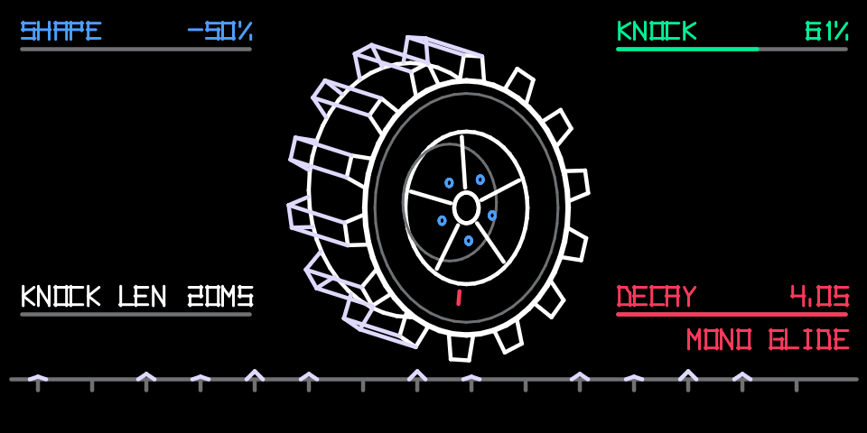

# TYR8

An 808 bass synth for the original Teenage Engineering OP-1 running the
[Hundekraft](https://hundekraft.github.io/op1-workshop/) custom firmware. It is one plugin file, `tyr8.knl`,
installed through the Hundekraft workshop.



*Screen preview rendered on a PC; the OP-1's own renderer may differ in detail.*

- **Needs:** an original OP-1 (not the OP-1 field) on Hundekraft 3.3 or later. Older cores refuse the file.
- **Status:** early release. A plugin runs inside the OP-1's audio engine, and a faulty one can hang the unit until
  it is switched off. Back up first and use it at your own risk.

## Install

1. Download `tyr8.knl` from the [releases](../../releases) page.
2. Open the [workshop](https://hundekraft.github.io/op1-workshop/) in a browser with Web MIDI (Chrome or Edge) and
   connect the OP-1 by USB.
3. Under **Your plugins**, add `tyr8.knl`. Press **Review changes**, then **Send to OP-1**, then **T1** on the OP-1.
4. After it restarts: **synth → Shift + T1 → tyr8**.

To update, add the newer file the same way; it replaces the old one. To remove it, use **Remove** under **Your
plugins**. Sounds saved with tyr8 keep their name and come back if you reinstall.

## Controls

Each encoder has a value on a plain turn, a second with **Shift** held, and blue, green and white have a third
reached by **pushing** the encoder (push again to go back). The corner of the screen in that encoder's colour shows
which value the knob is on and what it is set to.

### Turn

| Encoder | Label | Range | What it does |
|---|---|---|---|
| Blue | `SHAPE` | −50 → 150 % | The oscillator's wave. 0 % is a sine, 50 % a triangle, 100 % a saw. Below 0 % and above 100 % the output is fed back into the oscillator: a little thickens it, a lot breaks it up until there is no steady pitch. |
| Green | `KNOCK` | 0 → 100 % | How far the pitch starts above the note before dropping onto it: the kick at the front of the 808. Up to 16 times the note's frequency. |
| White | `KNOCK LEN` | 20 ms → 1.5 s | How long that pitch drop takes. Short is a click, long is a slow dive. |
| Orange | `DECAY` | 0.1 → 4 s | How long the note rings. It also sets the size of the tyre on screen. |

### Shift + turn

| Encoder | Label | Range | What it does |
|---|---|---|---|
| Blue | `DRIVE` | 0 → 100 % | Distortion before the clipper, up to 30 dB of gain: fatter, then gritty and growling. |
| Green | `CLIP` | 0 → 100 % | The final clipper, from a rounded soft clip to a hard brick wall driven harder. Harder is squarer and brighter. It also sets the tread on the tyre, slick to off-road. |
| White | `SUSTAIN` | 0 → 100 % | The level a held note settles at. At 0 every note is a one-shot that rings for the full decay however short the key press. |
| Orange | `GLIDE` | 0 → 500 ms | How long the pitch takes to slide between overlapping notes. Only used in `MONO GLIDE`. |

### Push, then turn

| Encoder | Label | Range | What it does |
|---|---|---|---|
| Blue | `SUB` | 0 → 100 % | Blends a clean sine at the note under the driven sound, to keep the low end solid. |
| Green | `TONE` | 100 → 0 % | A low-pass filter after the drive. 100 % is fully open; lower is darker. |
| White | `ATTACK` | 0 → 100 ms | Fades the start of the note in, to sit it behind a separate kick. |
| White (push twice) | `SAG` | 0 → 100 % | The pitch falls steadily while the note lasts, by up to two octaves over the decay. Leave it at 0 for held basslines. |

### Orange push: play mode

Pushing orange steps through three modes. The current one is shown under the orange label.

| Mode | What it does |
|---|---|
| `MONO GLIDE` | One voice. A note played while another is held and still sounding does not restart: the pitch glides to it. Letting go glides back to the key still held. |
| `MONO RETRIG` | One voice. Every note restarts on its own pitch with no glide. Letting go restarts the key still held. |
| `POLY` | Up to six notes at once, each at half level. No glide. |

### Good to know

- **Pitch:** the engine sounds two octaves below the key, so the OP-1's octave 0 is already bass.
- **Envelope:** TYR8 shapes its own level. The OP-1's envelope page (T2) has no effect on it.
- **Loudness:** the clipper is always last and always driven, so the output is at full scale at any setting. Drive
  and clip add density, not peak level.
- **Saving:** every value above, and the play mode, is saved with the sound. Which knobs are pushed is not.
- **Lowest notes:** the OP-1 filters its synth output below about 35 Hz, so the very lowest notes lose weight.

## Signal path

Oscillator (with feedback from the output) → amp envelope → drive → tone → sub → clipper → attack fade.

## Build from source

```sh
./build.sh          # fetches the SDK on first run, runs the checks, writes build/tyr8.knl
./build.sh test     # checks only, no Docker: writes build/out/*.wav and build/out/screen_*.png
```

Needs gcc, python3, curl, and Docker for the plugin file. The first full build makes a `bfin-elf-toolchain` image
from `toolchain/Dockerfile` (Blackfin GCC 13.3.0; about five minutes, once). The script downloads the Hundekraft 3.3
source and SDK into `sdk/`, verifies its checksum, and packs with the SDK's own `tools/kennel/pack.py`.

- `plugin/tyr8/` — `tyr8.c` (engine and screen), `plugin.json`, and `gen_svg.py`, which writes `tyr8.svg` and
  `tyr8_geom.h`.
- `test/` — checks that build the plugin for the PC and test what it promises, plus a preview renderer for the
  screen. These are stand-ins for the firmware, not an emulator.
- `toolchain/` — the cross-compiler image.

The audio code is integer-only fixed point, as the SDK requires: it runs in the OP-1's audio interrupt at 88.2 kHz.

## License and credits

GPL-3.0-or-later with the OP-1 firmware permission; see `LICENSE` and `NOTICE`. Built on the kennel plugin SDK by
Hundekraft and op1r by pcppcp. Not affiliated with Teenage Engineering.
